# TimeSheet Web App

React frontend for the [TimeSheet API](https://github.com/AbdalruhmanIssa/TimeSheet): employees log project hours, managers and directors approve them in two steps, and everyone sees where each project budget stands.

## Features by role

| Role | Pages |
|---|---|
| **Employee** | Dashboard (today vs. the daily cap, this week, last 14 days chart, rejected alerts) · **My time**: log, edit, cancel, resubmit rejected entries, and see each entry's review history |
| **Manager** | Dashboard (pending queue, budget health) · **Approvals**: approve, reject with a comment, bulk approve · **Projects** with budget, balances and per-employee reports, plus PDF export |
| **Director** | Everything a manager has, plus budget impact on every pending entry, **reopen** approved entries, create and edit projects, change status, manage the team, **Portfolio** (problem projects first) and **Clients** |
| **Admin** | Dashboard (users per role) · **Users**: create, edit, change role, reset password, block or unblock, delete |

Dashboards and approval queues refresh every 30 seconds; the API has no push channel.

## Screenshots

Taken against the API's Development demo data.

### Employee

| Dashboard | Log hours | My time |
|---|---|---|
| 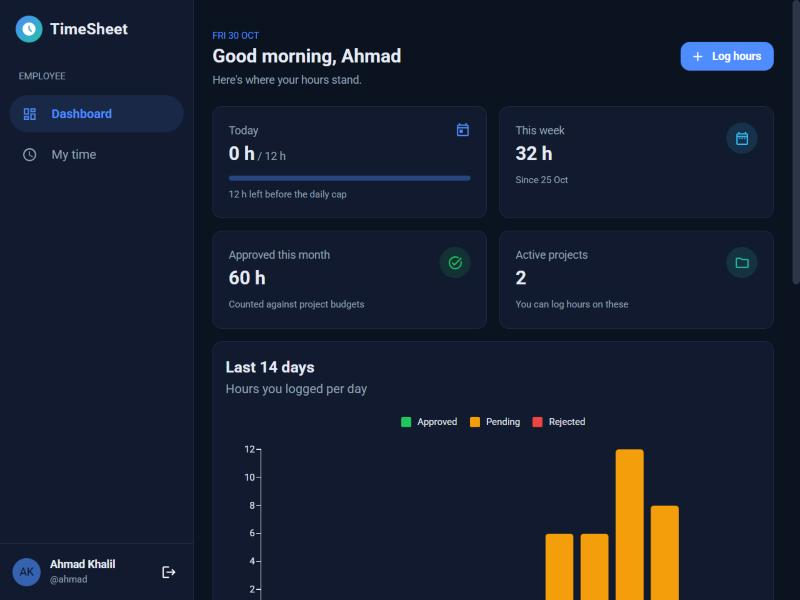 | 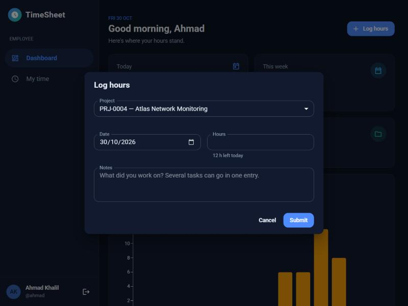 | 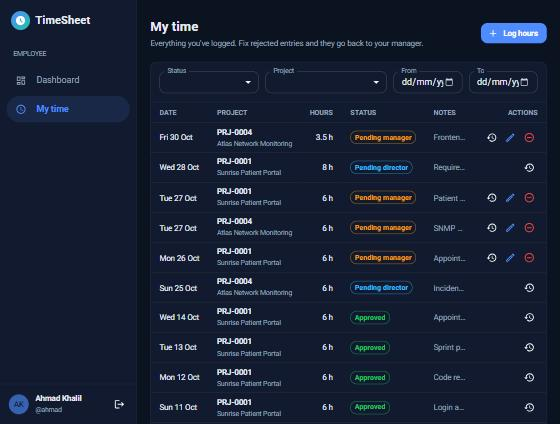 |

### Manager

| Dashboard | Approvals |
|---|---|
| 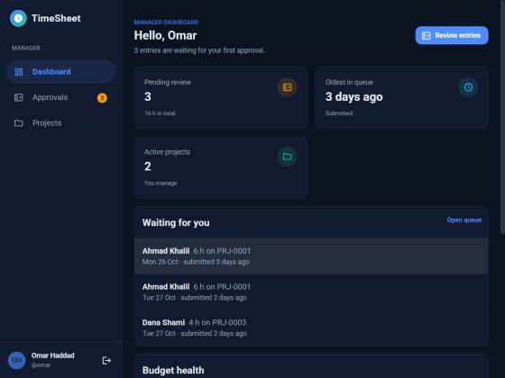 | 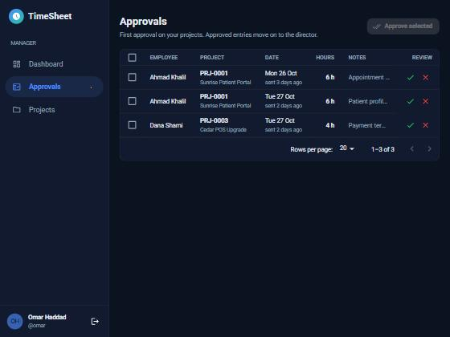 |

### Project reports (Manager and Director)

| Budget | Balances | By employee |
|---|---|---|
| 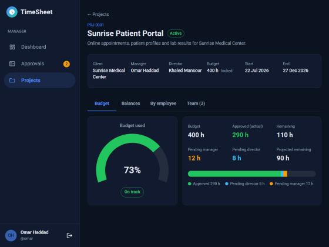 | 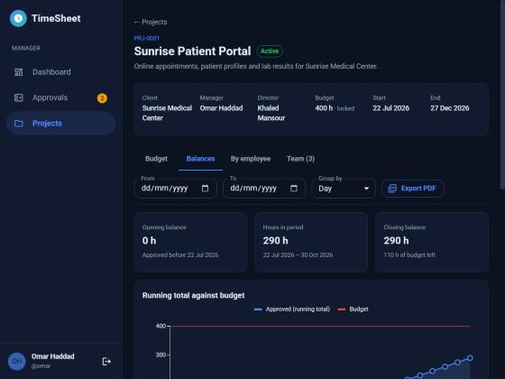 | 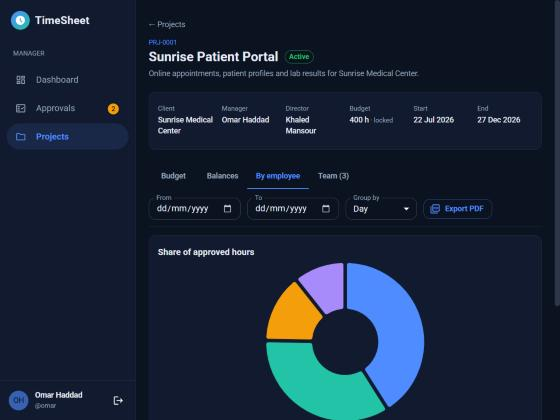 |

### Director

| Dashboard | Projects needing attention | Approvals with budget impact |
|---|---|---|
| 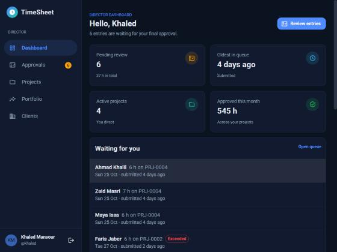 | 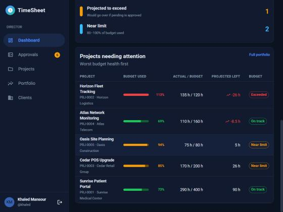 | 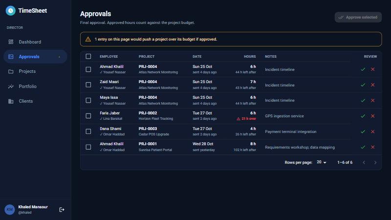 |

| Approved this session | Reopen dialog | Entry reopened |
|---|---|---|
| 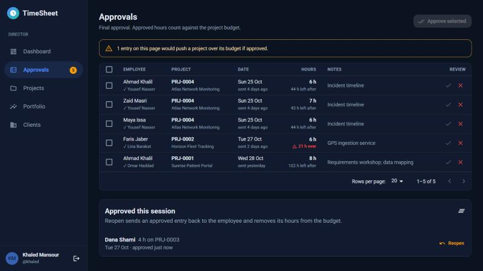 | 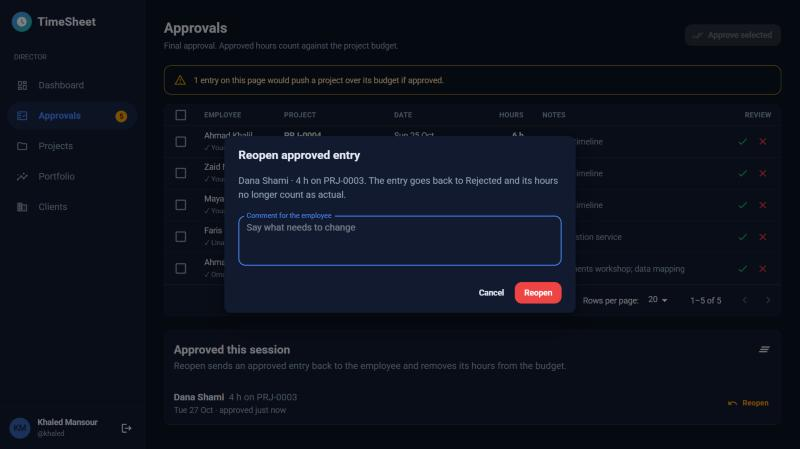 | 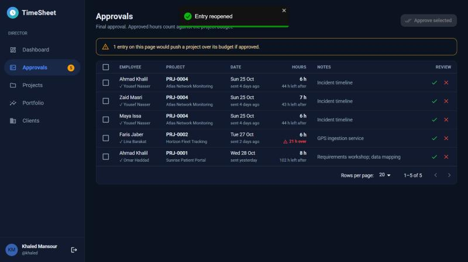 |

| Projects | New project | Clients |
|---|---|---|
| 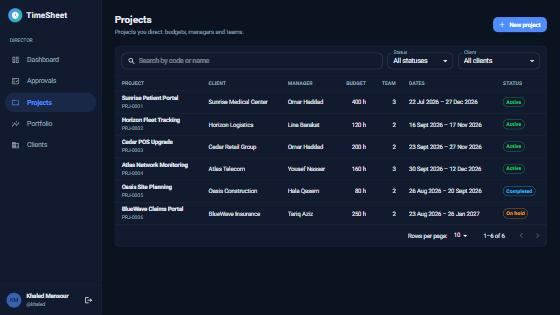 | 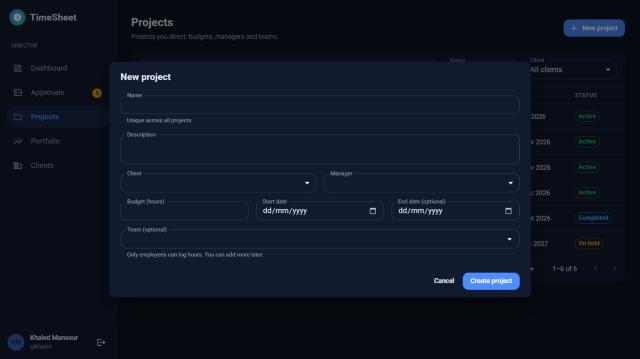 | 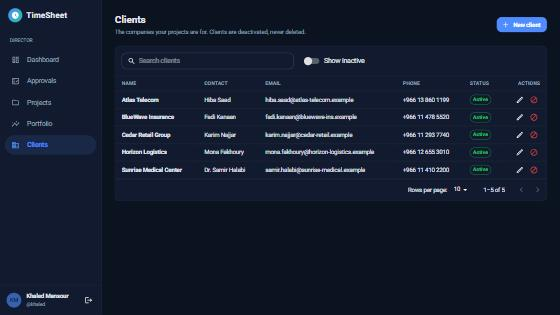 |

### Admin

| Dashboard | Users |
|---|---|
| 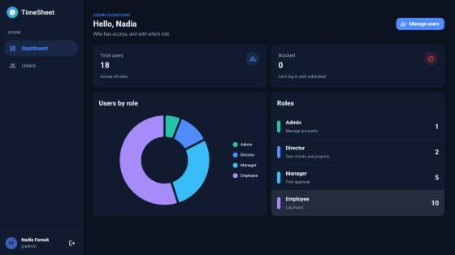 | 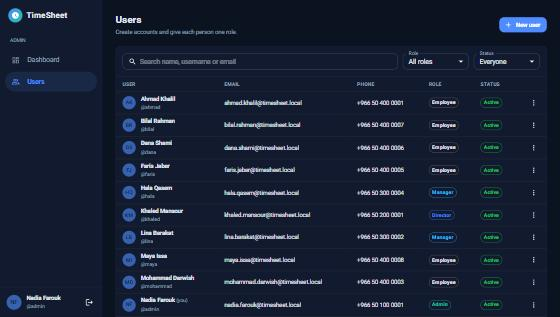 |

## Tech stack

Same libraries and patterns as [BrainovaProject](https://github.com/shathazyadeh/BrainovaProject):

| | |
|---|---|
| Build | Vite + React 19 |
| UI | MUI 7 + MUI X Charts, Roboto |
| Data | TanStack Query + axios |
| State | Zustand (auth session) |
| Forms | react-hook-form + yup |
| Routing | react-router-dom 7 |
| Feedback | react-toastify |
| Auth | JWT bearer token, decoded with `jwt-decode` |

## Getting started

**Requirements:** Node 20+ and the TimeSheet API running (by default on `http://localhost:5180`).

```bash
npm install
cp .env.example .env
npm run dev
```

Then open http://localhost:5173.

`.env`:

```
VITE_API_BASE_URL=http://localhost:5180/api/
```

When the API runs in Development it seeds demo users. The login page shows one-click demo accounts in dev builds; set `VITE_SHOW_DEMO_ACCOUNTS=true` to show them in a production build too.

## Scripts

| | |
|---|---|
| `npm run dev` | Dev server with hot reload |
| `npm run build` | Production build to `dist/` |
| `npm run preview` | Serve the build locally |
| `npm run lint` | ESLint |

## Project structure

```
src/
├── Api/axiosInstance.js     base url, adds the Bearer token, logs out on 401
├── store/                   useAuthStore (token + user from claims), recent approvals
├── hooks/
│   ├── generalHooks/        useFetch, useApiMutation (post/put/patch/delete), useDownloadPDF, useDebounce
│   ├── authHooks/           useLogin, useLogout
│   └── employeeHooks/ approvalHooks/ projectHooks/ reportHooks/ clientHooks/ userHooks/ dashboardHooks/
├── validations/schemas.js   yup schemas that mirror the API's rules
├── layout/                  AuthLayout, DashboardLayout (role guard + sidebar)
├── components/              common, navigation, timeEntries, approvals, projects, reports, clients, users, requestStates
├── pages/
│   ├── authPages/           Login
│   ├── employeePages/       EmployeeDashboard, MyEntries
│   ├── sharedPages/         ReviewerDashboard, Approvals, Projects, ProjectDetails (Manager + Director, by `area`)
│   ├── directorPages/       Clients, Portfolio
│   └── adminPages/          AdminDashboard, UserManagement
├── theme/theme.js           MUI dark theme
└── route.jsx                one route tree per role: /employee, /manager, /director, /admin
```

### Conventions

- **Every request goes through a hook.** `useFetch(url, queryKey, { params })` reads data, and `usePost / usePut / usePatch / useDelete` write it. Call `mutate(data)` for a fixed url, or `mutate({ url, data })` when the url carries an id.
- **Query keys start with the role area** (`["director", ...]`), so a write refreshes that area with one `invalidate: [["director"]]`.
- **The API's error message is shown as is.** The API answers `{ success: false, message }`. Forms show it inline (`serverError`); other actions show it as a toast.
- **Manager and Director share pages.** Each page takes an `area` prop that picks the API area (`Manager/...` or `Director/...`).
- **Dates.** `DateOnly` values (`"2026-10-30"`) are formatted without time-zone conversion. "Today" comes from the API (the business time zone), never from the browser clock.

## Notes

- The API has no endpoint that lists approved entries for a director. Reopen is offered on the entries the director approved in the current browser session (**Approved this session** on the Approvals page).
- The token is kept in `localStorage`. The app logs out when the token expires, and whenever the API answers 401 (blocked, deleted or re-roled user).
- For static hosting, rewrite every path to `index.html` so client-side routes work on refresh.
